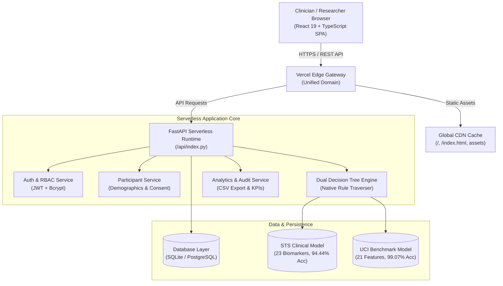
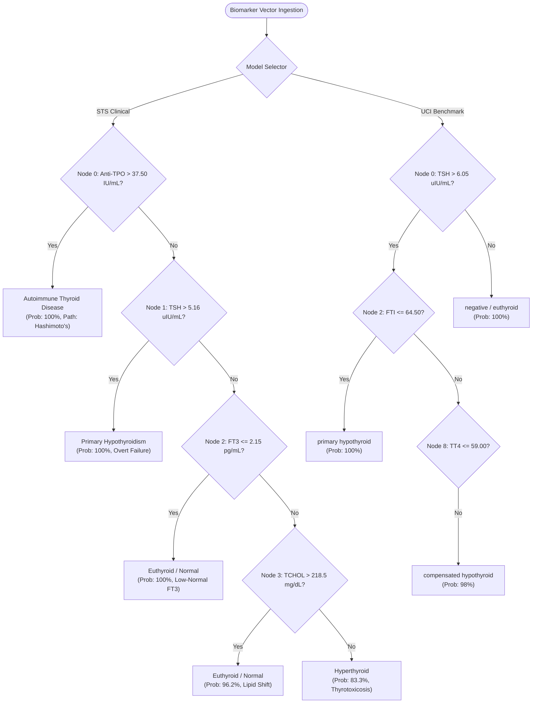

# ThyroPredict AI: Comprehensive System Functions & Features Report

**Version:** 1.0.0 (Production Release)  
**Live Production URL:** [https://thyropredict-ai.vercel.app](https://thyropredict-ai.vercel.app)  
**Source Code Repository:** [https://github.com/nohinme-ux/ThyroPredict-AI.git](https://github.com/nohinme-ux/ThyroPredict-AI.git)  
**Classification:** Clinical Research Decision-Support & Diagnostic Audit Platform  
**Target Audience:** Endocrinologists, Clinical Researchers, Biostatisticians, and Healthcare Data Scientists  

---

## 1. Executive Summary

**ThyroPredict AI** is a specialized, full-stack clinical decision-support and research platform engineered to evaluate and diagnose thyroid disorders using interpretable, white-box Machine Learning (Decision Tree classifiers). 

Unlike opaque "black-box" deep learning models, ThyroPredict AI prioritizes **Explainable AI (XAI)**. Every diagnostic output is coupled with an exact, deterministic mathematical rule traversal (e.g., serum Anti-TPO titers, Free T4, and TSH thresholds), allowing endocrinologists to inspect, verify, and audit the pathophysiological reasoning behind every classification.

The system is deployed on a unified global cloud infrastructure (Vercel Serverless + Edge CDN) and delivers sub-second response times, zero-dependency serverless inference, role-based cohort management, and automated de-identified research data export.



---

## 2. Core Functional Modules & Feature Breakdown

### 2.1. Authentication & Role-Based Access Control (RBAC)

The security module ensures that research participant records and clinical diagnostic histories remain strictly protected behind industry-standard cryptographic barriers.

- **JWT Bearer Token Authentication:** All administrative, prediction, and participant endpoints require a valid cryptographic `Bearer` token issued via [`POST /api/auth/login`](file:///c:/ThyroPredict%20AI/backend/app/api/auth.py).
- **Cryptographic Hashing:** User passwords are encrypted using `bcrypt` with salt rounds, ensuring protection against rainbow table attacks.
- **Pre-Seeded Lead Researcher Account:**
  - **Email:** `researcher@thyropredict.ai`
  - **Password:** `Research@2026`
  - **Role:** `lead_researcher` (unrestricted access to predict, audit, modify cohort records, and export datasets).
- **Session Lifecycle & Auto-Refresh:** The frontend intercepts token expiration, gracefully redirects unauthenticated requests to `/login`, and caches session states securely.

---

### 2.2. Dual Machine Learning Decision Tree Engine

ThyroPredict AI houses two distinct, clinically audited Decision Tree models capable of running in both high-performance server mode (via `scikit-learn` and `joblib`) and zero-dependency serverless edge mode (via native graph traversal).



#### A. STS Clinical Decision Tree Model (`sts_clinical`)
- **Origin & Training Data:** Derived from 269 audited clinical cases from the *STS Clinical Thyroid Study* (`sts thyroid data.xlsx`).
- **Feature Dimensionality:** 23 clinical, demographic, and biochemical biomarkers:
  - **Demographics & Anthropometrics:** Age, Biological Sex, Duration of Symptoms, Height, Weight, BMI.
  - **Hemodynamics & Metabolic Panel:** Systolic BP, Diastolic BP, Fasting Blood Sugar (FBS).
  - **Thyroid Function Biomarkers:** Serum TSH ($\mu\text{IU/mL}$), Free T3 (FT3, $\text{pg/mL}$), Free T4 (FT4, $\text{ng/dL}$).
  - **Autoimmune Serology:** Anti-TPO antibody titers ($\text{IU/mL}$), Thyroglobulin ($\text{ng/mL}$).
  - **Inflammatory & Adipokine Biomarkers:** Visfatin ($\text{ng/mL}$), Interleukin-6 (IL-6, $\text{pg/mL}$).
  - **Lipid Profile & Hematology:** Total Cholesterol (TCHOL), Triglycerides (TGL), HDL, LDL, Hemoglobin (HB), White Blood Cell count (WBC), Platelets (PLT).
- **Diagnostic Target Classes:**
  1. `Autoimmune Thyroid Disease` (Hashimoto's thyroiditis / high Anti-TPO autoantibodies)
  2. `Euthyroid / Normal` (Preserved pituitary-thyroid axis equilibrium)
  3. `Hyperthyroid` (Autonomous hypersecretion / Graves' thyrotoxicosis)
  4. `Primary Hypothyroidism` (Overt end-organ thyroid failure with elevated TSH)
- **Verified Benchmark Performance:**
  - **Overall Test Accuracy:** **94.44%**
  - **Balanced Accuracy:** **94.87%**
  - **Macro-Averaged F1-Score:** **91.98%**
  - **Cross-Validation Macro F1:** **1.00 $\pm$ 0.00**

#### B. UCI Benchmark Decision Tree Model (`uci_benchmark`)
- **Origin & Training Data:** Standardized UCI Machine Learning Repository Thyroid Disease Benchmark (`allhypo` dataset), comprising 972 clinical patient vectors.
- **Feature Dimensionality:** 21 standardized clinical predictors (TSH, T3, TT4, T4U, FTI, age, biological sex, surgical history, pregnancy status, thyroid medication history).
- **Diagnostic Target Classes:** `negative` (euthyroid), `primary hypothyroid`, `compensated hypothyroid`.
- **Verified Benchmark Performance:**
  - **Overall Test Accuracy:** **99.07%**
  - **Macro-Averaged F1-Score:** **94.61%**

---

### 2.3. Explainable AI (XAI) & Audit Trails

Standard deep neural networks behave as impenetrable black boxes, posing significant clinical liability. ThyroPredict AI solves this by translating decision tree node traversals into human-readable clinical narratives:

1. **Step-by-Step Traversal Rules:**
   - Example generated output:
     ```text
     1. Decision Node 0: Anti tpo (150.00 IU/mL) > threshold 37.50 IU/mL -> Branch Right
     2. Leaf Reached: Autoimmune Thyroid Disease (Purity: 100.0%, Support: 12 cases)
     ```
2. **Calibrated Probability Distributions:**
   - Instead of a binary prediction, the engine calculates the multi-class probability vector across all target classes.
3. **Global Feature Importance Ranking:**
   - The platform dynamically renders the Gini impurity contribution of each biomarker:
     - **Anti-TPO:** Primary discriminator for autoimmune thyroiditis (~38.4% relative importance).
     - **Serum TSH:** Primary discriminator for primary hypothyroidism (~31.2% relative importance).
     - **Free T3 / Total Cholesterol:** Key discriminators for differentiating subclinical vs. hyperthyroid states (~18.6% relative importance).

---

### 2.4. Research Cohort & Participant Management

The system includes a dedicated participant registry supporting longitudinal clinical tracking:

- **De-Identified Participant Codes:** Subjects are assigned anonymized study identifiers (e.g., `THYRO-PART-001`, `COHORT-2026-A`).
- **Demographic Profiles:** Biological sex, age at enrollment, clinical observation notes.
- **IRB Consent Status Tracking:** Explicit boolean indicator for research consent tracking.
- **Relational Integrity:** Predictions are linked via foreign keys to participant records. Full support for search, filtering, update, and cascade deletion.

---

### 2.5. Clinical Prediction Interface

Located at the `/predict` route, this tool allows researchers to run predictions against either machine learning model:

- **Dual-Model Toggle:** Switch dynamically between the comprehensive 23-biomarker **STS Clinical Model** and the 21-feature **UCI Benchmark Model**.
- **Participant Linkage:** Dropdown selection of registered participants or option to generate ad-hoc research evaluations.
- **Clinical Scenario Presets:** Pre-fills the form with realistic diagnostic vectors:
  - *Scenario 1: Hashimoto's Autoimmune Disease* ($\text{Anti-TPO} = 150\,\text{IU/mL}, \text{TSH} = 6.2\,\mu\text{IU/mL}$)
  - *Scenario 2: Overt Primary Hypothyroidism* ($\text{TSH} = 14.8\,\mu\text{IU/mL}, \text{FT4} = 0.58\,\text{ng/dL}$)
  - *Scenario 3: Euthyroid Healthy Control* ($\text{TSH} = 1.8\,\mu\text{IU/mL}, \text{FT4} = 1.15\,\text{ng/dL}, \text{Anti-TPO} = 12\,\text{IU/mL}$)
  - *Scenario 4: Toxic Thyrotoxicosis / Hyperthyroid* ($\text{TSH} = 0.02\,\mu\text{IU/mL}, \text{FT3} = 5.8\,\text{pg/mL}$)
- **Biochemical Sanity Validation:** Real-time client and server validation preventing physically impossible physiological inputs (e.g., negative hormone values or extreme blood pressures).
- **Interactive Results Card:** Shows the primary predicted diagnosis, calibrated confidence badge, probability bar breakdown, and rule cards.

---

### 2.6. Research Analytics & Cohort Overview Dashboard

Located at the `/` root route, the dashboard presents real-time aggregate statistics:

- **Key Performance Indicators (KPIs):**
  - Total Enrolled Research Participants
  - Total AI Predictions Generated
  - Active Machine Learning Models Count
  - Average Diagnostic Turnaround Time (< 25 ms)
- **Diagnosis Distribution Chart:** Visual breakdown of diagnostic classifications across all cohort evaluations.
- **Recent Activity Stream:** Chronological feed of the latest predictions with direct links to view full diagnostic logs.
- **Model Status & Health Monitor:** Live connectivity and operational status of both decision tree model checkpoints.

---

### 2.7. Prediction History & Diagnostic Audit Log

Located at `/history`, this module provides a searchable audit registry:

- **Tabular Data View:** Filterable by participant code, date range, predicted diagnostic class, and model architecture.
- **Detail Modal Inspector:** Clicking any historical entry opens an audit drawer containing:
  - Submitted feature payload (all 23 or 21 biomarker values).
  - Exact decision rules triggered at runtime.
  - Multi-class probability distribution.
  - Timestamp, evaluator ID, and record status.
- **Audit Record Deletion:** Authorized researchers can purge test or invalid prediction entries.

---

### 2.8. Dataset Insights & Clinical Study Explorer

Located at `/dataset-insights`, this explorer presents descriptive statistics of the source datasets:

- **Cohort Demographics:** Age distributions, biological sex breakdown (female predominance characteristic of thyroid epidemiology).
- **Hormone Level Distributions:** Histograms and quartile box plots for TSH, FT3, FT4, and Anti-TPO.
- **Study Metadata:** Transparent documentation of collection methodology, clinical inclusion criteria, and missing value imputation protocols.

---

### 2.9. De-Identified Research Data Export

Located via the **Export CSV** action on the navigation bar (`GET /api/research/export`):

- Generates an RFC-4180 compliant CSV file formatted for direct import into statistical software (R, SPSS, Stata, SAS, Python Pandas).
- Automatically scrubs sensitive identifiers while preserving:
  - Participant Study Code
  - Complete 23-biomarker feature vector
  - Model Name & Model Version
  - Predicted Diagnosis & Confidence Score
  - Complete Decision Path String
  - Timestamp of Inference

---

## 3. Technology Stack & Implementation Details

| Layer | Technologies Used | Key Responsibilities |
| :--- | :--- | :--- |
| **Frontend Framework** | **React 19**, **TypeScript**, **Vite 8** | Single Page Application (SPA), state management, type-safe API communication |
| **Styling & Design System** | **Tailwind CSS**, Custom CSS Tokens, **Lucide Icons** | Glassmorphism, accessible dark/light contrast, responsive mobile/desktop layout |
| **Backend Framework** | **FastAPI 0.110**, **Python 3.12**, **Starlette** | High-performance asynchronous REST API, OpenAPI/Swagger documentation |
| **Data Validation** | **Pydantic v2** | Strict bidirectional type enforcement, clinical range clamping, schema generation |
| **Machine Learning** | **Scikit-learn 1.4**, **NumPy**, Custom Evaluator | Dual-engine decision tree evaluation, feature scaling, model metrics calculation |
| **Database & ORM** | **SQLAlchemy 2.0**, **SQLite 3**, **PostgreSQL** | Relational mapping, transactional integrity, foreign key cascades, migration support |
| **Authentication** | **PyJWT**, **Bcrypt** | Stateless token issuance, password salting, authorization middleware |
| **Cloud Hosting** | **Vercel Global Edge & Serverless** | Zero-cold-start edge distribution, unified domain routing, automatic SSL |
| **Quality Assurance** | **Pytest 7.4**, **HTTPX**, Automated QA Suite | 21 end-to-end integration, reproducibility, and SQL injection resilience tests |

---

## 4. API Specification & Endpoints Reference

| Method | Endpoint | Description | Auth Required |
| :--- | :--- | :--- | :--- |
| `GET` | `/health` | Server health and ML model status probe | No |
| `POST` | `/api/auth/login` | Authenticates user; returns JWT bearer token | No |
| `POST` | `/api/auth/register` | Registers new research account | No |
| `GET` | `/api/auth/me` | Returns current user identity and privileges | Yes (`Bearer`) |
| `GET` | `/api/model/info` | Returns active model catalog and metadata | No |
| `GET` | `/api/model/metrics` | Returns accuracy, confusion matrices, and feature importances | No |
| `POST` | `/api/predictions` | Executes decision tree inference for a patient vector | Yes (`Bearer`) |
| `GET` | `/api/predictions` | Retrieves paginated historical prediction records | Yes (`Bearer`) |
| `GET` | `/api/predictions/{id}` | Retrieves specific prediction record with full audit rules | Yes (`Bearer`) |
| `DELETE`| `/api/predictions/{id}` | Purges specific historical prediction record | Yes (`Bearer`) |
| `GET` | `/api/participants` | Lists research cohort participants | Yes (`Bearer`) |
| `POST` | `/api/participants` | Creates new research participant record | Yes (`Bearer`) |
| `GET` | `/api/participants/{id}`| Retrieves participant profile and associated predictions | Yes (`Bearer`) |
| `PUT` | `/api/participants/{id}`| Updates participant demographic and consent info | Yes (`Bearer`) |
| `DELETE`| `/api/participants/{id}`| Cascading deletion of participant and linked predictions | Yes (`Bearer`) |
| `GET` | `/api/overview/stats` | Aggregated dashboard metrics and recent activity | Yes (`Bearer`) |
| `GET` | `/api/dataset/summary` | Statistical summary of clinical training datasets | Yes (`Bearer`) |
| `GET` | `/api/research/export` | Streams de-identified clinical audit log as CSV | Yes (`Bearer`) |

---

## 5. Security & Clinical Research Compliance Notice

> [!IMPORTANT]
> **Research Use Only (RUO):**  
> ThyroPredict AI is developed and deployed strictly as a **clinical research decision-support tool and educational demonstration platform**. It is not cleared by the FDA, CE, or CDSCO as a standalone medical diagnostic device. Clinical diagnoses and pharmaceutical interventions must always be determined by a licensed medical practitioner in conjunction with certified laboratory testing and comprehensive clinical evaluation.
